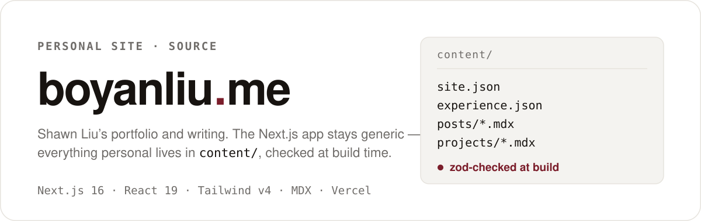
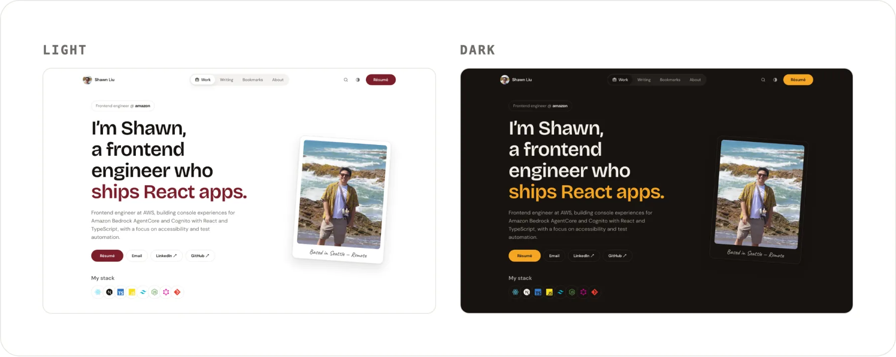
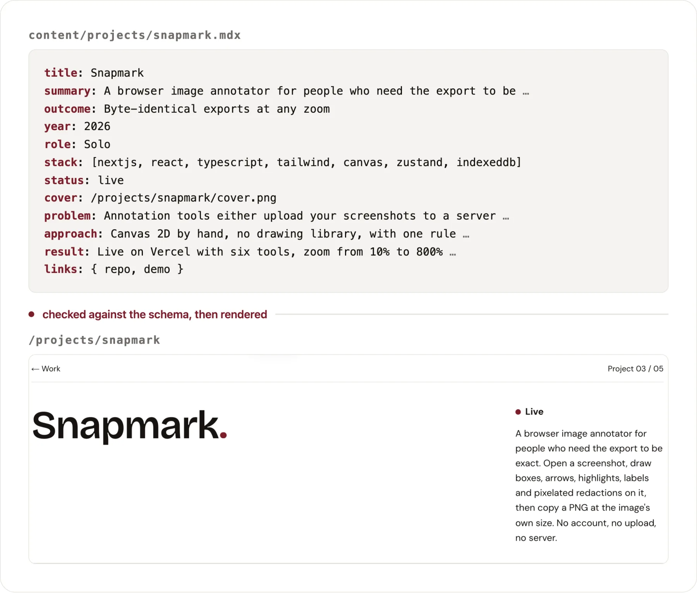

<p align="center">
  
</p>

<p align="center">
  <a href="https://boyanliu.me"><strong>boyanliu.me</strong></a> ·
  <a href="https://boyanliu.me/projects">Work</a> ·
  <a href="https://boyanliu.me/blog">Writing</a> ·
  <a href="https://boyanliu.me/bookmarks">Bookmarks</a> ·
  <a href="https://boyanliu.me/resume">Résumé</a>
</p>

The portfolio and blog of **Shawn Liu** ([@BoyanLiuu](https://github.com/BoyanLiuu)): case studies, writing, bookmarks, an expandable work history and a printable résumé. `src/` is a generic Next.js app; everything personal lives in `content/`, typed with zod and checked when the site builds — so a typo fails CI instead of reaching the live page.

## The site



One set of tokens, two themes. Tailwind's default palette, radii and shadows are switched off in `src/app/globals.css`, so a stray `bg-blue-500` or `rounded-lg` produces no CSS at all. Both accents have to pass WCAG AA, and the build refuses them if they don't.

Every pull request runs the unit tests, Playwright smoke tests and Lighthouse budgets — **performance ≥ 85** (median of three runs), **accessibility ≥ 95**, **SEO ≥ 95**. One browser test is the recruiter "5-second test": at 1440×900, before scrolling, the headline and the résumé and contact links have to be on screen.

## How content becomes a site


A case study is one MDX file, and its frontmatter is the page:



Invalid JSON or frontmatter stops `pnpm dev` and `pnpm build` with a readable error. Drafts (`draft: true`) appear in `pnpm dev` only.

## Run it

Node 24+ and pnpm via Corepack.

```bash
corepack enable
pnpm install
pnpm dev     # http://127.0.0.1:3000 — loopback only; Ctrl+G overlays the 12/8/4 column grid
```

```bash
pnpm check                # typecheck + lint + unit tests + production build
pnpm build && pnpm start  # start serves the last build and does NOT pick up edits
pnpm test:e2e             # Playwright smoke tests (run pnpm build first)
```

## Content

Everything personal is in `content/`. VS Code autocompletes each JSON file from its sibling `*.schema.json`.

| File              | What it holds                                                                    |
| ----------------- | -------------------------------------------------------------------------------- |
| `site.json`       | Role, email, location, bio, socials, availability, accent colours, feature flags |
| `experience.json` | Roles with impact bullets and dates; education                                   |
| `bookmarks.json`  | Repos, blogs, articles and sites, each with a one-line note                      |
| `changelog.json`  | Dated entries for `/changelog`                                                   |
| `projects/*.mdx`  | The case studies. Covers live in `public/projects/<slug>/` at 16:10              |
| `posts/*.mdx`     | Writing. A post published elsewhere first sets `canonical` to the original URL   |

The résumé is `public/resume.pdf` and every Résumé button opens it. Generate it from the `/resume` page with `pnpm build && pnpm resume:pdf --force`.

## Scripts

| Script                                                | What it does                                                                                                         |
| ----------------------------------------------------- | -------------------------------------------------------------------------------------------------------------------- |
| `pnpm new:post "Title"`                               | Creates `content/posts/<slug>.mdx` as a draft with the recommended outline                                           |
| `pnpm new:project "Title"`                            | Creates `content/projects/<slug>.mdx` as a draft                                                                     |
| `pnpm new:bookmark <url> [--note "…"] [--tags a,b]`   | Adds a bookmark, fetching title, description and kind from the link (GitHub repos via the API); `--dry-run` previews |
| `pnpm media:video <in> public/projects/<slug>/<name>` | Converts a screen recording to MP4 + WebM + poster (needs `ffmpeg`)                                                  |
| `pnpm resume:pdf --force`                             | Replaces `public/resume.pdf` with a printout of `/resume`                                                            |
| `pnpm schemas`                                        | Regenerates `content/*.schema.json` from the zod schemas                                                             |
| `pnpm format`                                         | Prettier with Tailwind class sorting                                                                                 |

## Writing in MDX

Posts and projects are Markdown or MDX with validated frontmatter (see `content-collections.ts`). Available in a document:

- GitHub-flavoured Markdown — tables, task lists, footnotes — plus maths (`$…$`, `$$…$$`) and highlighted code with a copy button
- `<Callout title="…">` and `<Figure src alt caption />`
- `<YouTube id title />` (click-to-load) and `<Playground src title />` (StackBlitz and CodeSandbox only)
- `series` + `seriesOrder` to chain posts; `featured: true` puts one in "Start here"

Beyond the pages themselves: ⌘K search, tags shared between posts and projects, related posts, a paginated archive, case-study media as screenshot, video loop or SVG, a GitHub activity tile, a changelog, résumé short links `/r` and `/p/<slug>`, Open Graph images, JSON-LD, RSS/Atom/JSON feeds and a sitemap.

## Design

A warm workshop: ink on paper, soft rules and one oxblood stamp, laid out on a 12/8/4 column grid. Bricolage Grotesque for display, DM Sans for body text, Caveat for the handwritten notes, all through `next/font`. [DESIGN.md](DESIGN.md) records the full token set.

- **Accent colours** — `theme.accent` and `theme.accentDark` in `content/site.json`, both checked for WCAG AA at build time.
- **Features** — `features.search`, `features.analytics` and `analytics.customEvents` in `content/site.json`.
- **Tokens, type scale, grid** — the `@theme` block in `src/app/globals.css`; fonts in `src/app/layout.tsx`.
- **New fields** — frontmatter goes in `content-collections.ts`; new site settings go in `src/config/schema.ts`, then run `pnpm schemas`. The committed schema files are generated from `src/config/json-schemas.ts`, never hand-edited, and a unit test fails when they drift.

## Deploy

Hosted on Vercel, static-first, with a preview deployment per pull request.

1. Import the repo (framework preset: Next.js, no build overrides).
2. Set `NEXT_PUBLIC_SITE_URL=https://boyanliu.me`.
3. Add `boyanliu.me`, redirect `www.boyanliu.me` to it, and update DNS as Vercel instructs.

**Analytics.** `features.analytics` loads cookie-free Vercel Web Analytics; also turn on **Analytics → Web Analytics** in the Vercel project (free on Hobby: page views, referrers, countries, devices; 50k events a month, one month of history). Visits from the résumé short links show in the **Pages** panel under `/from-resume/…`. Click events for the Résumé, Email, LinkedIn and GitHub links are wired up but need a Pro plan — set `analytics.customEvents` to `true` after upgrading.

**CI.** `.github/workflows/ci.yml` runs format, typecheck, lint, unit tests and build, then the Playwright and Lighthouse checks above. `links.yml` runs a lychee link check on content changes and weekly.

## Licence

- **Code** — [MIT](LICENSE).
- **Content** (posts, project write-ups, images) — © Shawn Liu, all rights reserved.
- **Fonts** — Bricolage Grotesque, DM Sans and Caveat are served by `next/font` under the SIL Open Font License. Inter Tight ships in `src/assets/fonts/` for Open Graph image generation, also SIL OFL (`OFL.txt`).
